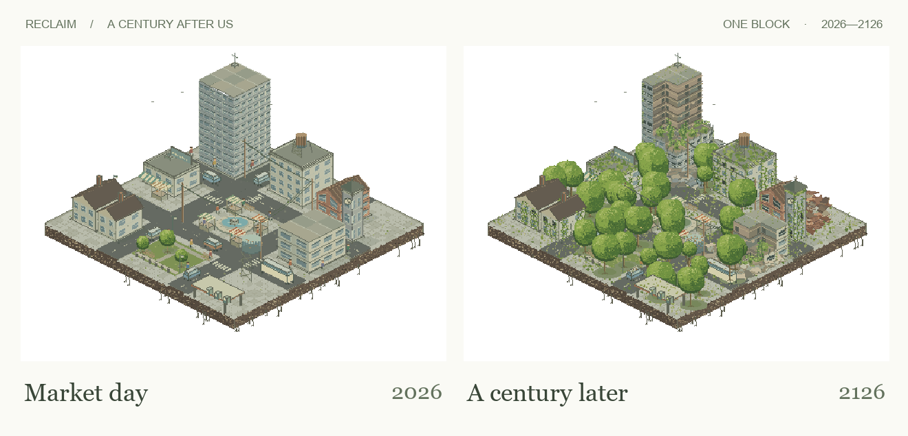
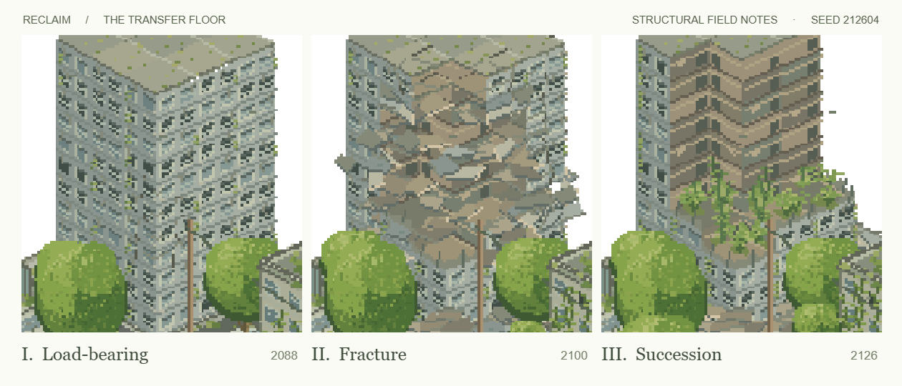

# Reclaim · A Century After Us

In 2026, the fountain runs and the last bus still crosses the square. A century later, you can look through the side of the tower and find ferns growing where the third floor used to meet the wall. Drag the year backward. Every piece finds its way home.

**[Explore the city](https://luzbel33.github.io/reclaim-pixel/)** · [Watch the 24-second film](https://luzbel33.github.io/reclaim-pixel/media/reclaim.mp4) · [Try the benchmark](BENCHMARK.md)

## Look closer

- **2056 · The old brickworks.** Mortar splits along the edge of the pitched roof. The roof tiles and masonry land in different places.
- **2074 · East apartments.** A footing gives way. Look down into the missing corner: the floors next door still sit at their original height.
- **2100 · The transfer floor.** A failure partway up the tower travels into the wing above. Pause on a slab in flight, then scrub back and follow the same slab again.
- **2126 · Succession.** Moss, ferns and climbing ivy occupy the newly exposed floors. The large trees are rooted outside the buildings.

## Controls

| Action          | Input                                                                         |
| --------------- | ----------------------------------------------------------------------------- |
| Visit a year    | Drag the timeline, use its arrow keys, or press Play                          |
| Orbit and tilt  | Drag sideways to orbit; drag **down** to raise the camera, **up** to lower it |
| Zoom / pan      | Scroll or pinch to zoom; Shift + drag to pan                                  |
| Keyboard camera | Focus the scene. ← → rotate, ↑ ↓ change elevation, + / − zoom, Home resets    |
| Day / night     | Use the sun in the top right                                                  |

## Run it

Download the repository and open **`index.html`** in a modern browser. There is no install, build step or network request to draw the city. The finished film is included in `media/`; the interactive page does not download it at startup.

The city is drawn to a **480 × 360 Canvas 2D**. Streets, people, foliage and facades come from code. A fixed seed builds the load paths once. A failed bay releases pieces of its original walls, floors or roof; each rotates in flight and keeps its resting place. Ambient time drives pedestrians, birds and water separately from the year. This is an artistic model of decay, not a structural engineering simulation.

| Source        | Responsibility                                                                                                                                                                                |
| ------------- | --------------------------------------------------------------------------------------------------------------------------------------------------------------------------------------------- |
| `city.js`     | Pixel rasterizer, world layout, projection, actors and foliage                                                                                                                                |
| `fracture.js` | Support graph, fracture geometry, landings and conditions for interior growth                                                                                                                 |
| `masonry.js`  | Facade materials, exposed rooms, airborne pieces, dust and plants                                                                                                                             |
| `app.js`      | Timeline, camera gestures, keyboard input and reduced motion                                                                                                                                  |
| `studio/`     | [Ten reproducible field checks](https://luzbel33.github.io/reclaim-pixel/studio/checks.html) and a [frame-by-frame film renderer](https://luzbel33.github.io/reclaim-pixel/studio/index.html) |

## Reference

Inspired by **[Post Humans by @zzzzshawn](https://x.com/zzzzshawn/status/2116436345082302946)**. [Explore the original on Forge.](https://forge.ui8.ai/share/frag_704ba1d5-05f4-44bf-bc62-34322dfaa1e1) Its compact city and year slider were the starting point. The artwork, code, fracture system and film in this repository were made for this independent recreation.
